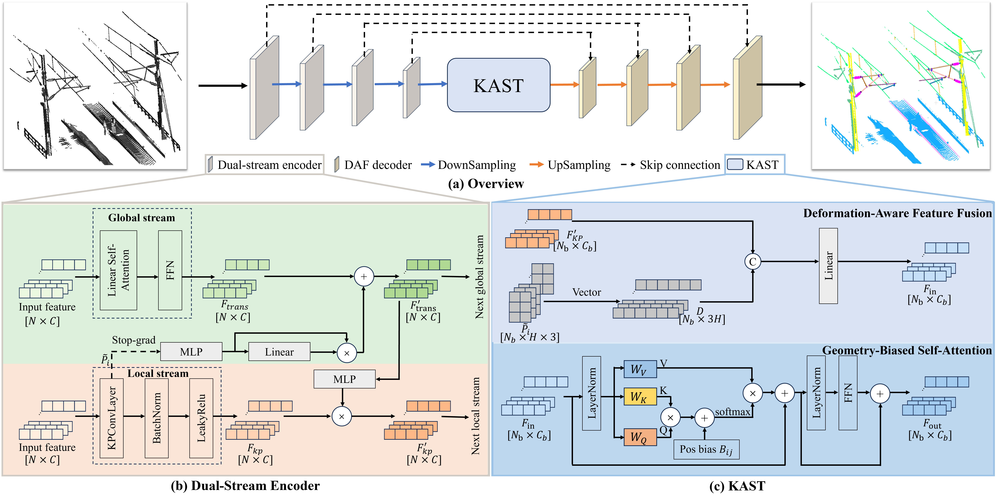
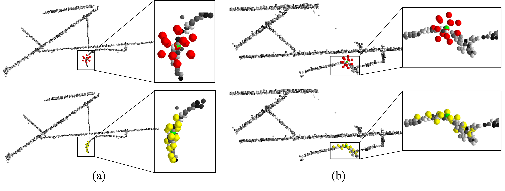
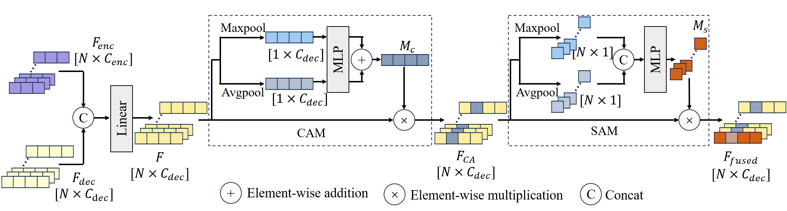
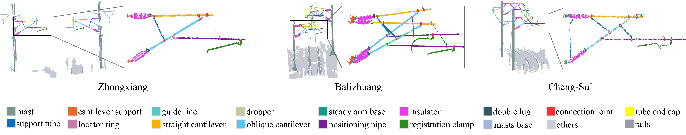
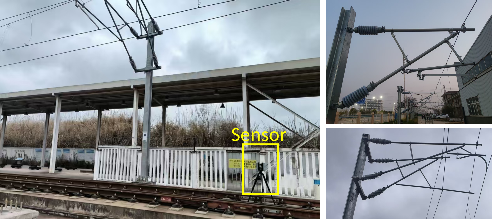
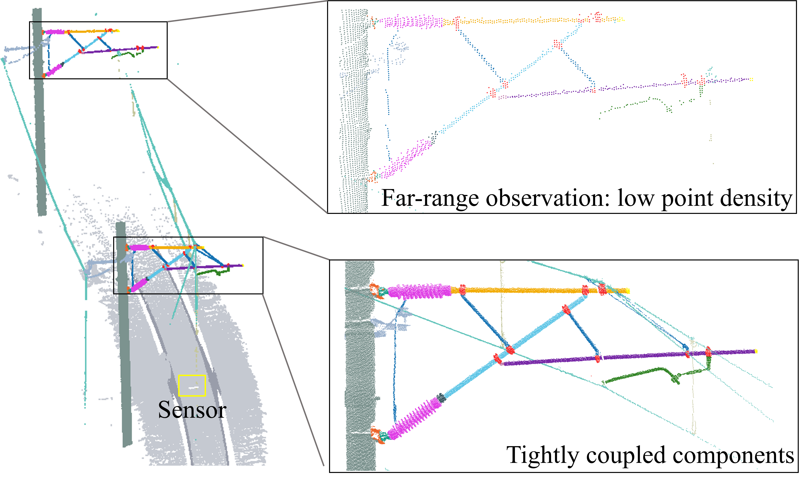
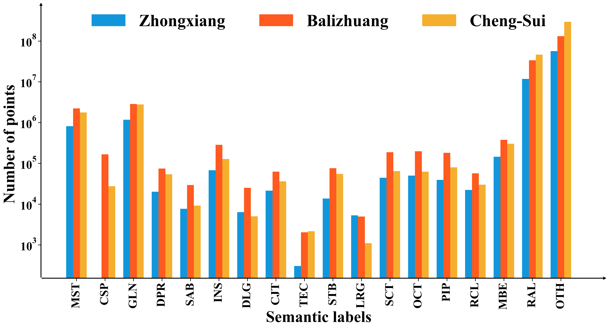
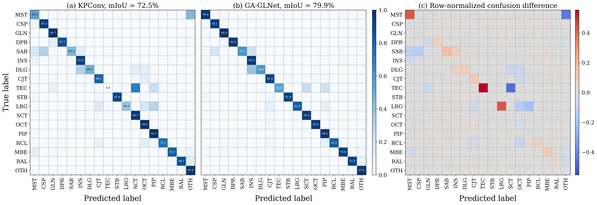
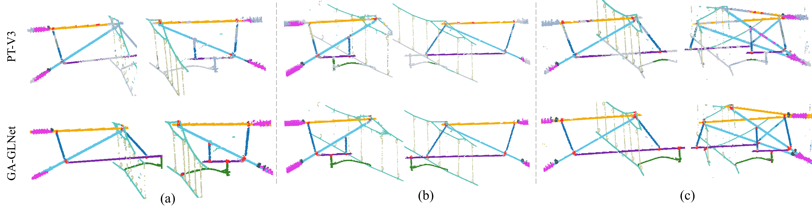

# GA-GLNet & TLS-OCS3D

### A Geometry-Aware Global-Local Network for Railway Overhead Contact System Point Cloud Segmentation

**Fine-grained railway point cloud segmentation through local geometry and global structural context.**

[Introduction](#introduction) · [Method](#method) · [Dataset](#tls-ocs3d-dataset) · [Results](#results) · [Visualizations](#visualizations) · [Availability](#availability)

## Introduction

Railway overhead contact systems (OCS) contain small, tightly connected components with similar local geometry. Nonuniform point density, occlusion, and incomplete observations make their fine-grained segmentation challenging.

**GA-GLNet** couples deformable local geometric modeling with global structural context. A dual-stream encoder exchanges information at every stage, a **Kernel-Adaptive Spatial Transformer (KAST)** refines bottleneck features, and **Dual-Attention Fusion (DAF)** preserves discriminative information during decoding.

We also introduce **TLS-OCS3D**, a terrestrial laser scanning benchmark with approximately **591 million annotated points**, **61 scans**, and **18 semantic classes**, including **12 individual cantilever-component classes**.

| TLS-OCS3D test mIoU | TLS-OCS3D test mAcc | Cross-dataset mIoU |
| :---: | :---: | :---: |
| **79.9%** | **87.8%** | **67.5%** |

The cross-dataset result is measured on 51 reannotated OCS-Dataset samples over 11 target classes, without target-domain fine-tuning. It uses a different evaluation protocol from the 18-class TLS-OCS3D test set.

## Method

### 1. Dual-stream encoder

The four-stage encoder combines two complementary streams:

- **Local geometric stream:** deformable KPConv adapts kernel locations to local point distributions, capturing thin structures and small connection fittings.
- **Global context stream:** linear self-attention captures long-range dependencies among components within an assembly.
- **Stage-wise bidirectional interaction:** learned kernel configurations provide geometric cues to the global stream; the updated global features then modulate local feature channels. Stop-gradient separates the local-to-global interaction path from deformable offset learning.

Both streams share aligned point sets through hierarchical grid subsampling.

*Kernel adaptation: green indicates the query point, red the rigid kernel points, and yellow the deformed kernel points. The deformed configuration follows local component geometry more closely.*

### 2. KAST: Kernel-Adaptive Spatial Transformer

KAST introduces geometry into bottleneck refinement through two pathways, illustrated in panel (c) of the architecture figure:

- **Deformation-aware feature fusion:** vectorized deformed kernel configurations are concatenated with the deepest local features and projected into a joint representation.
- **Geometry-biased self-attention:** relative point displacements produce head-specific attention biases, allowing attention to consider spatial relationships as well as feature similarity.

Dense geometry-biased attention is applied only at the downsampled bottleneck to limit computational cost.

### 3. DAF: Dual-Attention Fusion

During resolution recovery, DAF fuses upsampled decoder features with skip-connected encoder features. **Channel attention** selects informative feature channels, followed by **spatial attention** that reweights individual points. This sequential refinement helps retain small-component and boundary information.

## TLS-OCS3D Dataset

TLS-OCS3D covers three railway collection areas and retains both fine-grained cantilever components and surrounding railway context. Each point contains 3D coordinates and intensity.

| Collection area | Scans | Semantic classes | Approximate points | Cantilever configuration |
| :--- | ---: | ---: | ---: | :--- |
| Zhongxiang | 19 | 17 | 71 million | Single |
| Balizhuang | 16 | 18 | 172 million | Single and double |
| Cheng-Sui | 26 | 18 | 348 million | Single |
| **Total** | **61** | **18 overall** | **591 million** | |

The fixed benchmark split contains **47 training / 7 validation / 7 test scans**. Scans are partitioned by station order within each area, with validation scans between training and test portions and overlapping validation-test regions cropped.

*Full scenes preserve railway context; enlarged views reveal the fine-grained component annotations.*

<b>Semantic classes, acquisition, and dataset challenges</b>

**12 cantilever components:** cantilever support (CSP), support tube (STB), locator ring (LRG), straight cantilever (SCT), oblique cantilever (OCT), positioning pipe (PIP), steady arm base (SAB), insulator (INS), double lug (DLG), connection joint (CJT), tube end cap (TEC), and registration clamp (RCL).

**6 contextual classes:** mast (MST), guide line (GLN), dropper (DPR), mast base (MBE), rails (RAL), and others (OTH). Zhongxiang does not contain CSP.

*Data acquisition with a UNRE UCL360Pro terrestrial laser scanner, including single- and double-cantilever configurations.*

*Scanning distance changes point density, while tightly coupled components create ambiguous local boundaries.*

*Class-wise point counts illustrate the substantial imbalance between small fittings and large contextual classes.*

## Results

### Standard TLS-OCS3D benchmark

All values below are percentages reported in the manuscript on the fixed 18-class test set. Checkpoints are selected by validation mIoU.

| Method | mIoU (%) | mAcc (%) |
| :--- | ---: | ---: |
| PointNet | 16.3 | 20.6 |
| PointNet++ | 29.8 | 37.2 |
| DGCNN | 22.1 | 33.7 |
| KPConv | 72.5 | 76.4 |
| RandLA-Net | 54.6 | 65.2 |
| PT-V1 | 50.5 | 58.3 |
| PT-V2 | 56.7 | 64.9 |
| OACNN | 51.9 | 63.8 |
| PT-V3 | 77.2 | 84.9 |
| **GA-GLNet (Ours)** | **79.9** | **87.8** |

GA-GLNet improves mIoU by **7.4 percentage points over KPConv** and **2.7 percentage points over PT-V3**. Gains are class dependent; the model does not lead on every component category.

### Generalization

| Evaluation setting | KPConv | PT-V3 | GA-GLNet |
| :--- | ---: | ---: | ---: |
| Leave-one-area-out: average mIoU across three held-out areas | 31.4 | 51.5 | **52.0** |
| TLS-OCS3D → OCS-Dataset: mIoU over 11 target classes | 55.7 | 57.6 | **67.5** |

Leave-one-area-out evaluation excludes the test area from both training and validation. GA-GLNet improves over PT-V3 on Balizhuang and Cheng-Sui, while PT-V3 performs better on the lower-density Zhongxiang area. Cross-dataset evaluation uses models trained exclusively on TLS-OCS3D and 51 target samples reannotated with the TLS-OCS3D taxonomy, without fine-tuning.

<b>Architectural ablation</b>

| Configuration | mIoU (%) |
| :--- | ---: |
| KPConv-based baseline | 72.4 ± 0.3 |
| Baseline + dual-stream encoder | 76.2 ± 0.2 |
| Baseline + KAST | 75.7 ± 0.3 |
| Baseline + DAF | 74.1 ± 0.1 |
| Dual-stream encoder + KAST | 76.8 ± 0.4 |
| Dual-stream encoder + DAF | 77.6 ± 0.6 |
| **Complete GA-GLNet** | **80.3 ± 0.4** |

These ablation results are **mean ± standard deviation over three independent training runs**. The 80.3% ablation mean is distinct from the 79.9% result in the main comparison table.

## Visualizations

### Segmentation comparison

*Test scenes from (a) Zhongxiang, (b) Balizhuang, and (c) Cheng-Sui. Rows show the input, ground truth, and predictions from four methods. Enlarged regions highlight small fittings and component interfaces, where GA-GLNet reduces fragmented or merged predictions in the displayed examples.*

### Class-wise confusion

*Rows denote true classes and columns predicted classes. Diagonal entries are per-class recall, not IoU; the difference map is GA-GLNet minus KPConv. Tube end cap recall rises from 0.0% to 55.4%, and locator ring recall from 39.1% to 82.4%.*

### Cross-dataset transfer

*Qualitative comparison on three OCS-Dataset samples without target-domain fine-tuning. PT-V3 is shown in the top row and GA-GLNet in the bottom row; colors follow the semantic labels above.*

## Availability

This repository currently provides the paper overview and visualization figures. Training code, pretrained weights, and the full TLS-OCS3D dataset are not included in this release. The manuscript states that data will be made available upon reasonable request.

